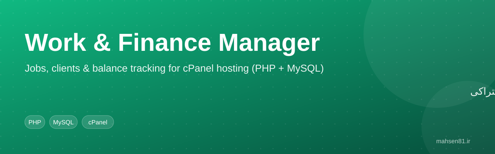

<!-- gen:header -->
<p align="center"></p>

<h1 align="center">Work & Finance Manager</h1>
<p align="center"><b>سیستم مدیریت کارها، کارفرماها و حساب‌ها روی هاست اشتراکی</b><br><i>Jobs, clients & balance tracking for cPanel hosting (PHP + MySQL)</i></p>
<p align="center">  </p>

<div dir="rtl">

## ✨ امکانات

- سه نقش: مدیر، همکار و پورتال مشتری
- وضعیت کار با درصد محاسبه در مانده حساب
- ثبت پرداخت و محاسبه‌ی خودکار مانده
- بدون Composer؛ نصب با چند کلیک

</div>

## 🚀 Quick start

```bash
Upload crm/ to public_html → open /install
```

---

<!-- gen:docs -->
## 📚 مستندات کامل · Full documentation

# سیستم مدیریت کارها و امور مالی

یک سیستم تحت وب ساده (PHP + MySQL) برای مدیریت کارفرماها، ثبت کارها (با قیمت و وضعیت انجام)، ثبت پرداخت‌ها و محاسبه خودکار مانده حساب. مناسب برای اجرا روی هاست اشتراکی با کنترل‌پنل cPanel، بدون نیاز به Composer یا نصب هیچ نرم‌افزار خاصی.

## امکانات

- ورود چند کاربره با نقش‌های:
  - **مدیر کل**: دسترسی کامل + مدیریت کاربران و تنظیمات
  - **همکار/کارمند**: دسترسی کامل به کارفرماها، کارها و پرداخت‌ها
  - **کارفرما (پورتال مشتری)**: فقط مشاهده کارها، وضعیت و مانده حساب خودش
- تعریف کارفرما/پروژه، ثبت کارها با قیمت و وضعیت (شروع نشده / در حال انجام / انجام شده - قابل تغییر و افزودن وضعیت دلخواه از تنظیمات)
- هر وضعیت یک «درصد قابل محاسبه» دارد (مثلا کار در حال انجام ۵۰٪ در مانده حساب لحاظ می‌شود) - دقیقا مطابق منطقی که در فایل اکسل قبلی‌تان استفاده کرده بودید
- ثبت پرداخت‌ها و محاسبه خودکار: مجموع هزینه کارها، مبلغ قابل محاسبه، مجموع پرداختی و مانده حساب - هم برای هر کارفرما و هم به صورت کلی در داشبورد
- داده‌های نمونه از روی فایل اکسل شما (کارفرمای «اسکارد» با همه کارها و پرداخت‌ها) از قبل وارد شده تا همان لحظه اول سیستم را با اطلاعات واقعی ببینید

## نصب روی هاست cPanel

### مرحله ۱: ساخت دیتابیس

۱. وارد cPanel شوید و به بخش **MySQL Databases** بروید.
۲. یک دیتابیس جدید بسازید (مثلا `crm`) - نام نهایی چیزی شبیه `cpaneluser_crm` خواهد شد.
۳. یک کاربر MySQL جدید بسازید و رمز عبور قوی برایش تعیین کنید.
۴. کاربر را به دیتابیس اضافه کنید (Add User to Database) و دسترسی **All Privileges** را به او بدهید.
۵. نام دیتابیس، نام کاربری و رمز عبور را یادداشت کنید - در مرحله بعد لازم می‌شود.

### مرحله ۲: وارد کردن ساختار دیتابیس

۱. از همان صفحه MySQL Databases یا از منوی اصلی cPanel وارد **phpMyAdmin** شوید.
۲. دیتابیسی که در مرحله قبل ساختید را از سمت راست انتخاب کنید.
۳. روی تب **Import** کلیک کنید.
۴. فایل `install/schema.sql` را انتخاب و روی **Go** کلیک کنید.
۵. بعد از اتمام، جداول (users، clients، jobs، payments، job_statuses، settings) باید ساخته شده باشند و یک کاربر مدیر و یک کارفرمای نمونه با کارها و پرداخت‌هایش در آن‌ها باشد.

### مرحله ۳: آپلود فایل‌ها

۱. وارد **File Manager** در cPanel شوید (یا از طریق FTP وصل شوید).
۲. به داخل `public_html` بروید (یا هر ساب‌دامنه/پوشه‌ای که می‌خواهید سیستم در آن باشد - مثلا `public_html/crm`).
۳. تمام فایل‌های این پروژه را در همان پوشه آپلود کنید (می‌توانید فایل zip پروژه را آپلود کرده و از داخل File Manager با گزینه Extract آن را از حالت فشرده خارج کنید).

### مرحله ۴: تنظیم فایل config.php

۱. در File Manager فایل `config.sample.php` را پیدا کنید، یک کپی از آن بگیرید (Copy) و نام کپی را به `config.php` تغییر دهید.
۲. فایل `config.php` را با ادیتور داخلی File Manager باز کنید و مقادیر زیر را با اطلاعات واقعی خودتان جایگزین کنید:
   - `DB_HOST` معمولا `localhost` است.
   - `DB_NAME` نام دیتابیسی که ساختید (مثلا `cpaneluser_crm`)
   - `DB_USER` نام کاربری MySQL که ساختید
   - `DB_PASS` رمز عبور همان کاربر
   - `APP_BASE_URL` آدرس کامل پوشه‌ای که برنامه در آن است، مثلا `https://yourdomain.com/crm`
   - `APP_SECRET` یک رشته تصادفی و طولانی و منحصربه‌فرد (فقط برای امنیت بیشتر - هر متن دلخواهی بگذارید)
   - `APP_FORCE_HTTPS` اگر سایتتان گواهی SSL دارد، این را `true` کنید تا کاربران همیشه با https وارد شوند.

### مرحله ۵: ورود اولیه و تغییر رمز عبور

۱. آدرس سیستم را در مرورگر باز کنید (مثلا `https://yourdomain.com/crm`).
۲. با اطلاعات زیر وارد شوید:
   - **نام کاربری:** `admin`
   - **رمز عبور:** `Admin@1405`
۳. بلافاصله بعد از ورود، از منوی «پروفایل من» (آیکون چرخ‌دنده بالای صفحه) رمز عبور را به یک رمز عبور قوی و اختصاصی تغییر دهید.

### مرحله ۶: ساخت کاربران دیگر

از منوی «کاربران» (فقط برای مدیر کل قابل مشاهده است):
- برای همکاران تیم خودتان کاربر با نقش «همکار/کارمند» بسازید.
- برای هر کارفرما (در صورت نیاز به این‌که خودشان وارد سیستم شوند و فقط کارها/مانده حساب خودشان را ببینند) یک کاربر با نقش «کارفرما» بسازید و آن را به کارفرمای مربوطه متصل کنید.

## نکات امنیتی

- فایل `.htaccess` همراه پروژه به‌صورت پیش‌فرض از دسترسی مستقیم به `config.php` و پوشه‌های `includes` و `install` جلوگیری می‌کند. مطمئن شوید هاست شما از `.htaccess` (Apache mod_rewrite/mod_authz) پشتیبانی می‌کند؛ اکثر هاست‌های cPanel به‌صورت پیش‌فرض این‌طور هستند.
- بعد از نصب موفق، بهتر است پوشه `install/` را کامل از روی هاست حذف کنید یا حداقل از دسترسی عمومی محافظت‌شده نگه دارید (در حال حاضر با `.htaccess` قفل شده است).
- رمز عبور کاربر مدیر پیش‌فرض را حتما همان ابتدا تغییر دهید.

## ساختار دیتابیس (خلاصه)

- `clients` - کارفرماها
- `job_statuses` - وضعیت‌های کار به همراه درصد قابل‌محاسبه هر وضعیت (قابل ویرایش از تنظیمات)
- `jobs` - کارها/پروژه‌ها (عنوان، هزینه، وضعیت، کارفرمای مربوطه)
- `payments` - پرداخت‌های دریافتی از هر کارفرما
- `users` - کاربران سیستم (مدیر/همکار/کارفرما)
- `settings` - تنظیمات کلی (نام سیستم، واحد پول)

فرمول مانده حساب هر کارفرما:

```
مانده حساب = مجموع (هزینه هر کار × درصد قابل‌محاسبه وضعیت آن کار) − مجموع پرداختی‌ها
```

این دقیقا همان منطقی است که در فایل اکسل قبلی شما استفاده شده بود (کار انجام‌شده ۱۰۰٪، در حال انجام ۵۰٪، شروع‌نشده ۰٪) با این تفاوت که این درصدها از صفحه «تنظیمات» در هر لحظه قابل تغییر هستند.

---

<p align="center">ساخته‌شده توسط <a href="https://mahsen81.ir"><b>محسن جباره‌اصل</b></a> — برنامه‌نویسی، طراحی سایت، ربات و هوش مصنوعی<br>
Built by <a href="https://mahsen81.ir">Mohsen Jabbareh-Asl</a> · ⭐ اگر مفید بود، ستاره بدهید · Need a custom version? <a href="https://mahsen81.ir">Get in touch</a></p>
